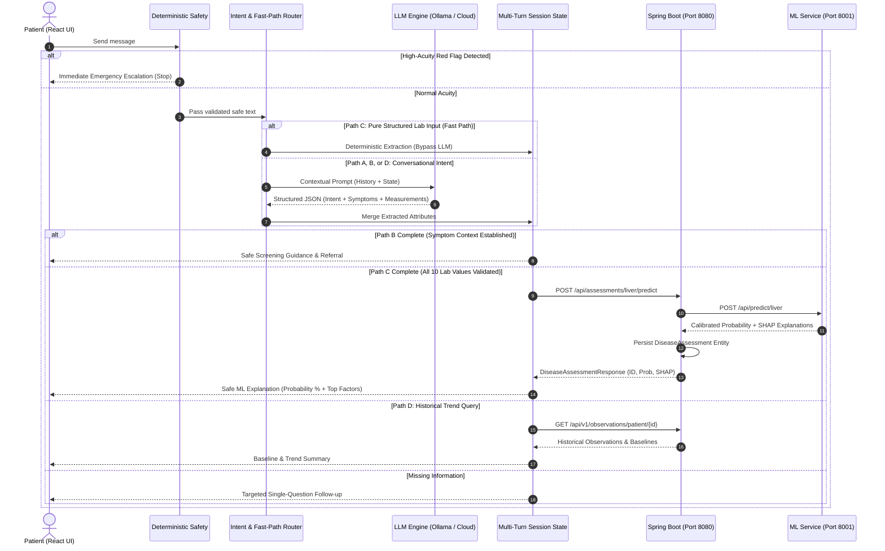

# Chatbot Architecture & Specification
## Smart Healthcare Platform — Conversational Clinical AI Subsystem

---

## 1. Product Goal

The Smart Healthcare Platform Conversational Assistant is an intelligent, safety-first, multi-turn clinical screening and patient-engagement interface. 

### What the Chatbot IS:
* A **conversational, personalized healthcare interface** where a patient can arrive with only natural-language symptoms or health concerns.
* A **safe, screening-oriented triage tool** that progressively gathers descriptive context (symptom onset, location, severity, duration, frequency, associated symptoms, medical history, medications).
* A **data-assisted assessment tool** that allows patients who possess laboratory reports or physiological readings to conversationally provide structured measurements for formal ML evaluation.
* A **context-aware patient assistant** that connects returning patients to their personal health baselines, metric trends, deviations, and historical assessments stored in the Spring Boot backend.
* A **research and educational screening system** designed with deterministic safety boundaries and transparent explainability (SHAP).

### What the Chatbot IS NOT:
* **NOT a rigid laboratory-value collection bot.** A patient must **never** need laboratory reports just to use the chatbot or receive guidance.
* **NOT an autonomous diagnostic engine.** The chatbot never claims: *"You have condition X"* or *"This proves disease Y."*
* **NOT a treatment prescriber.** It never prescribes medication, adjusts dosages, or replaces licensed clinical care.
* **NOT a probability generator.** The LLM never invents, guesses, or calculates disease probabilities or clinical risk scores.

---

## 2. User Journeys Supported

| Journey | Entry Context | User Inputs | System Output |
|---|---|---|---|
| **1. General Health Exploration** | Educational curiosity or wellness inquiry | "What is fatty liver?" or "How does blood pressure work?" | Clear, cautious medical explanation citing reliable wellness principles without diagnosing the user. |
| **2. Symptom-First Triage (No Lab Values)** | New health complaint (e.g., abdominal pain, dizziness) | Free-text symptoms, timing, severity | Progressive dialogue, safety check, non-diagnostic differential possibilities, recommended clinician consultation. |
| **3. Medical Report / Lab Value Assessment** | User possesses lab panel results (e.g., LFT liver report) | Conversational or pasted lab parameters (bilirubin, SGPT, albumin, etc.) | Validated structured extraction, Spring Boot & ML FastAPI inference, calibrated probability, SHAP explanation. |
| **4. Returning Patient Longitudinal Monitoring** | Patient tracking chronic trends or recent checkups | "How does my liver enzyme trend compare to my baseline?" | Spring Boot historical query, personal baseline comparison, deviation analysis, trend visualization guidance. |
| **5. High-Acuity Emergency Interception** | Critical symptoms (e.g., crushing chest pain, facial droop) | Free-text emergency indicators | Immediate deterministic halt, emergency escalation message (call 911 / emergency department). |

---

## 3. Four Core Chatbot Paths

```
                       User Input Message
                                │
                                ▼
            [ Deterministic Safety / Red-Flag Layer ]
                                │
               ┌────────────────┴────────────────┐
               ▼ (Critical Trigger)              ▼ (Normal Conversation)
       [ Emergency Handoff ]             [ Intent & Content Router ]
                                                 │
         ┌───────────────────┬───────────────────┼───────────────────┐
         ▼                   ▼                   ▼                   ▼
    [ Path A ]          [ Path B ]          [ Path C ]          [ Path D ]
  General Health       Symptom-First       Report / Lab       Returning User
   Conversation         Screening           Assessment          Monitoring
         │                   │                   │                   │
         ▼                   ▼                   ▼                   ▼
    Educational         Progressive         Structured          Historical
    Explanation          Symptom           10-Lab Validation     Baselines &
    (Cautious)          Follow-Ups          & ML Inference      Metric Trends
```

### Path A: General Health Conversation
* **Trigger:** Questions regarding medical definitions, terminology, normal physiological ranges, or wellness ("What does elevated AST mean?", "How does diet impact cholesterol?").
* **Execution:** Routed to the LLM with conversational context and safety constraints.
* **Contract:** The response must be informative, objective, and clearly state that general concepts do not constitute personal clinical evaluation. No patient-specific facts or lab values are fabricated.

### Path B: Symptom-First Conversation (Primary Clinical Journey)
* **Trigger:** Patient reports subjective symptoms ("I've had dull pain in my right side for three days").
* **Zero Lab Requirement:** The patient is **never** asked for laboratory values during initial symptom exploration.
* **Execution:**
  1. Deterministic safety check verifies absence of red flags.
  2. LLM extracts symptom parameters: symptom name, anatomical location, duration, onset, severity, frequency, progression, associated symptoms.
  3. Deterministic `FollowUpEngine` identifies missing descriptive dimensions.
  4. Chatbot generates natural, targeted follow-up inquiries.
  5. Upon reaching clinical descriptive completeness, the system provides safe screening-oriented guidance (e.g., *"These symptoms may be associated with hepatobiliary or gastrointestinal conditions. You should schedule an evaluation with a healthcare provider"*).

### Path C: Medical Report / Structured Data Assessment
* **Trigger:** Patient explicitly indicates they have test results ("I got my liver blood test results") or provides numerical lab metrics.
* **Execution:**
  1. Fast-path deterministic extractor or LLM parses values into canonical `Measurement` objects.
  2. Multi-turn state tracks collected vs. missing inputs across turns.
  3. When all required inputs for a production disease model (e.g., the 10 Liver fields) are validated within physical bounds, the chatbot formats a Spring Boot request.
  4. Spring Boot orchestrates ML FastAPI inference, calibration, SHAP calculation, and database persistence.
  5. Chatbot presents the real calibrated probability and SHAP factors in non-causal screening language.

### Path D: Returning Patient / Personalized Monitoring
* **Trigger:** Authenticated user queries historical context, trends, or previous assessments ("How do my enzymes look compared to last month?").
* **Execution:**
  1. Chatbot queries Spring Boot Observation and Baseline APIs for the authenticated `patientId`.
  2. Spring Boot retrieves historical observations, calculates the patient's personal baseline and standard deviations (Z-scores / contextual deviations).
  3. The chatbot formats a personalized explanation of whether the readings are stable, improving, or deviating from the patient's individual baseline.
  4. The LLM explains existing structured data without fabricating historical metrics.

---

## 4. Detailed Request / Response Sequence



---

## 5. Separation of Responsibilities

```
┌─────────────────────────────────────────────────────────────────────────────┐
│                            LLM RESPONSIBILITIES                             │
├─────────────────────────────────────────────────────────────────────────────┤
│ • Natural-language dialogue, tone normalization, empathy, and clarity.       │
│ • Intent classification (General, Symptom, Report, History, Monitoring).   │
│ • Conversational symptom extraction (location, severity, duration, onset).  │
│ • Natural phrasing of follow-up questions formulated by backend rules.      │
│ • Translation of structured SHAP explanations into accessible prose.         │
│ • General wellness education (strictly prohibited from diagnosing).         │
└─────────────────────────────────────────────────────────────────────────────┘
                                       ▲
                                       │ Non-authoritative extraction
                                       ▼
┌─────────────────────────────────────────────────────────────────────────────┐
│                    DETERMINISTIC BACKEND RESPONSIBILITIES                   │
├─────────────────────────────────────────────────────────────────────────────┤
│ • Pre-LLM Emergency Red-Flag detection (regex / clinical rule bank).        │
│ • State tracking: required, collected, and missing parameters.              │
│ • Strict boundary validation (age 1-120, positive lab numbers, unit check). │
│ • Fast-path regex lab extractor bypassing LLM when possible.                │
│ • Assessment handoff payload formulation.                                   │
│ • Authentication, authorization, and tenant isolation.                     │
└─────────────────────────────────────────────────────────────────────────────┘
                                       ▲
                                       │ Validated handoff
                                       ▼
┌─────────────────────────────────────────────────────────────────────────────┐
│                         DISEASE ML RESPONSIBILITIES                         │
├─────────────────────────────────────────────────────────────────────────────┤
│ • Serving trained clinical models (e.g., Logistic Regression for Liver).    │
│ • Strict preprocessing, feature alignment, and missing-value rejection.     │
│ • Isotonic probability calibration (real continuous probabilities).         │
│ • Production of model version and inference metadata.                       │
└─────────────────────────────────────────────────────────────────────────────┘
                                       ▲
                                       │ Raw feature weights
                                       ▼
┌─────────────────────────────────────────────────────────────────────────────┐
│                            SHAP RESPONSIBILITIES                            │
├─────────────────────────────────────────────────────────────────────────────┤
│ • Local feature attribution calculation (TreeSHAP / KernelSHAP).            │
│ • Signed feature importance values indicating relative impact on score.      │
│ • Strictly non-causal: identifies model weights, not biological causes.     │
└─────────────────────────────────────────────────────────────────────────────┘
                                       ▲
                                       │ Orchestrated inference
                                       ▼
┌─────────────────────────────────────────────────────────────────────────────┐
│                        SPRING BOOT RESPONSIBILITIES                         │
├─────────────────────────────────────────────────────────────────────────────┤
│ • Central orchestrator between Chatbot, ML Service, and MySQL.              │
│ • Durably persisting DiseaseAssessment entities and audit trails.           │
│ • Historical observation management (Objective 1).                          │
│ • Personal baseline calculation and contextual deviation alerts (Obj 2).    │
└─────────────────────────────────────────────────────────────────────────────┘
                                       ▲
                                       │ REST / JSON
                                       ▼
┌─────────────────────────────────────────────────────────────────────────────┐
│                            REACT RESPONSIBILITIES                           │
├─────────────────────────────────────────────────────────────────────────────┤
│ • Chat window UI, auto-scroll, typing states, and status badges.            │
│ • Visual cards for completed assessments (Probability, Risk Score, SHAP).   │
│ • Trend charts, baseline comparisons, and longitudinal tracking views.      │
│ • Direct manual assessment modals alongside the conversational assistant.   │
└─────────────────────────────────────────────────────────────────────────────┘
```

---

## 6. Safety & Red-Flag Architecture

### Deterministic Pre-Screening Protocol
1. **Pre-Execution Hook:** Every incoming user message passes through `SafetyChecker.evaluate(message)` **prior** to invoking any LLM client or fast-path extractor.
2. **Clinical Emergency Triggers:**
   - **Cardiovascular / Acute Coronary:** Crushing chest pain, radiation to jaw/left arm, chest tightness with dyspnea/diaphoresis.
   - **Severe Respiratory Distress:** Inability to breathe, turning blue, severe gasping, suffocation sensation.
   - **Neurological Deficit / Acute Stroke:** Sudden facial droop, unilateral hemiparesis, sudden loss of speech/slurring, thunderclap headache.
   - **Altered Mental Status / Syncope:** Loss of consciousness, unresponsiveness, syncope with trauma.
   - **Severe Hemorrhage:** Hematemesis, coughing up massive blood, uncontrolled arterial bleeding.
3. **Escalation Protocol:**
   - Safety status is marked as `URGENT_MEDICAL_EVALUATION`.
   - Workflow immediately halts further assessment processing.
   - Chatbot returns an emergency action directive instructing the patient to call emergency services (911/local emergency) or seek the nearest acute care facility.
   - No clinical follow-up questions or ML workflows are triggered.

---

## 7. Symptom-First Flow (Path B Detailed Specification)

When a user initiates a conversation without laboratory reports:

### Step 1: Ingestion & Initial Symptom Extraction
The user describes a problem: *"My stomach hurts and I feel sick."*
- Red-flag filter passes.
- LLM extracts: `symptoms: [{"name": "abdominal pain"}, {"name": "nausea"}]`.
- Unknown attributes remain `null`.

### Step 2: Progressive Context Gathering
The system determines which descriptive dimensions are unpopulated:
- Anatomical location (`location`)
- Duration (`duration`)
- Severity on a descriptive or 1–10 scale (`severity`)
- Onset timing (`onset`)
- Frequency / constancy (`frequency`)
- Relevant medical history or current medications

### Step 3: Targeted Single-Question Follow-up
The chatbot asks focused questions one turn at a time. It does **not** overwhelm the user with a clinical checklist.
- Turn 1: *"Where exactly in your abdomen are you experiencing the pain, and how long has it been present?"*
- User response: *"It's below my right ribs for two days."*
- Turn 2: *"Is the pain constant or does it come and go, and how severe would you rate it?"*
- User response: *"It comes and goes, moderate about 5 out of 10."*

### Step 4: Differential Screening Summary (No Medical Claims)
Once sufficient descriptive context is gathered, the system provides safe, non-diagnostic guidance:
- Summarizes the collected symptom profile.
- Explains potential anatomical or physiological systems involved in screening language:
  > *"Right upper quadrant abdominal pain that is intermittent and accompanied by nausea can be associated with gallbladder, liver, or gastrointestinal issues. Because these symptoms can stem from several distinct causes, an in-person clinical evaluation, physical exam, and appropriate diagnostic workup by a physician are recommended."*
- **Strict Boundary:** No fabricated probability percentage is displayed for symptoms without a validated symptom-based ML model.

---

## 8. Medical Report / Lab Assessment Flow (Path C Detailed Specification)

### Liver Disease Model Contract
For patients providing liver laboratory results, the existing production inference pipeline (`Logistic Regression + Isotonic Calibration`) requires exactly 10 parameters:

| Parameter | Canonical Key | Clinical Bounds | Unit |
|---|---|---|---|
| 1. Age | `age` | 1 – 120 | years |
| 2. Gender | `gender` | "Male" / "Female" | categorical |
| 3. Total Bilirubin | `total_bilirubin` | 0.0001 – 100.0 | mg/dL |
| 4. Direct Bilirubin | `direct_bilirubin` | 0.0 – 50.0 | mg/dL |
| 5. Alkaline Phosphatase | `alkaline_phosphatase` | 0.0001 – 5000.0 | IU/L |
| 6. SGPT (ALT) | `sgpt` | 0.0001 – 5000.0 | U/L |
| 7. SGOT (AST) | `sgot` | 0.0001 – 5000.0 | U/L |
| 8. Total Proteins | `total_proteins` | 0.0001 – 20.0 | g/dL |
| 9. Albumin | `albumin` | 0.0001 – 15.0 | g/dL |
| 10. A/G Ratio | `a_g_ratio` | 0.0001 – 10.0 | ratio |

### Multi-Turn Lab Accumulation
- Values may be supplied in any sequence across multiple conversation turns.
- Previously entered valid values remain in the session state.
- If a user inputs an out-of-range value (e.g., `age: 250`), an explicit validation message is displayed and the value is rejected without clearing previously accepted values.
- Missing values trigger targeted follow-up prompts listing **only** the uncollected metrics.

### Backend Execution & Persistence
Once all 10 fields are present and valid:
1. `Chatbot` invokes `POST http://localhost:8080/api/assessments/liver/predict`.
2. `Spring Boot` invokes `POST http://localhost:8001/api/predict/liver`.
3. `ML Service` runs preprocessing, calibrated logistic regression, and SHAP attribution.
4. `Spring Boot` saves a `DiseaseAssessment` record to the database (generating a durable `assessmentId`).
5. `Chatbot` receives `DiseaseAssessmentResponse` and displays:
   - Real calibrated probability (e.g., `61.6%`).
   - Assessment ID and model version.
   - Top contributing SHAP features in accessible, non-causal language.
   - Strict medical disclaimer requiring physician consultation.

---

## 9. Returning-Patient & Longitudinal Monitoring Flow (Path D Detailed Specification)

Path D leverages existing Spring Boot backend capabilities:

### Objective 1 & 2 Integration:
1. **Patient Context Acquisition:** When an authenticated patient converses with the chatbot, their `patientId` links the session to their health record.
2. **Historical Observation Queries:** The chatbot retrieves historical vitals and lab panels via Spring Boot:
   - `GET /api/v1/observations/patient/{patientId}`
   - `GET /api/v1/baselines/patient/{patientId}`
3. **Personal Baseline Analysis:**
   - Computes personal mean ($\mu$) and standard deviation ($\sigma$) over historical stable periods.
   - Evaluates current observation against personal baseline: $Z = \frac{x - \mu}{\sigma}$.
   - Identifies whether metric shifts represent acute deviations, gradual trends, or stable variations.
4. **Conversational Trend Explanation:**
   - The chatbot explains metric trajectories:
     > *"Looking at your records over the past 3 months, your AST has decreased from 120 U/L to 65 U/L, moving closer to your personal baseline of 45 U/L. This indicates a downward trend compared to your reading last month."*
   - Never fabricates historical observations. If data is absent, the chatbot states: *"I do not see prior lab records for this metric in your profile."*

---

## 10. Structured Data Contract

### Canonical Measurement Schema
All physical and laboratory measurements extracted by the system must adhere strictly to the Pydantic `Measurement` schema:

```json
{
  "name": "total_bilirubin",
  "value": 10.9,
  "unit": "mg/dL"
}
```

**Forbidden Structure:**
```json
{
  "measurements": [
    "Total Bilirubin (10.9 mg/dL)"
  ]
}
```

### Canonical Field Normalization Matrix
The system normalizes conversational clinical aliases into standard database and model keys:

| Raw Conversational Input / Aliases | Canonical Measurement Name | Standard Unit |
|---|---|---|
| `bilirubin`, `total bilirubin`, `t_bili`, `tbil` | `total_bilirubin` | `mg/dL` |
| `direct bilirubin`, `conjugated bilirubin`, `dbil` | `direct_bilirubin` | `mg/dL` |
| `alkaline phosphatase`, `alk phos`, `alp`, `alkphos` | `alkaline_phosphatase` | `IU/L` |
| `sgpt`, `alt`, `alanine transaminase`, `alanine aminotransferase` | `sgpt` | `U/L` |
| `sgot`, `ast`, `aspartate transaminase`, `aspartate aminotransferase` | `sgot` | `U/L` |
| `total proteins`, `total protein`, `protein`, `tp` | `total_proteins` | `g/dL` |
| `albumin`, `alb` | `albumin` | `g/dL` |
| `a/g ratio`, `ag ratio`, `a:g ratio`, `albumin to globulin ratio` | `a_g_ratio` | ratio |
| `blood pressure`, `bp systolic`, `systolic` | `blood_pressure_systolic` | `mmHg` |
| `bp diastolic`, `diastolic` | `blood_pressure_diastolic` | `mmHg` |
| `fasting glucose`, `blood sugar`, `glucose` | `glucose` | `mg/dL` |

---

## 11. Conversation State Model

```python
class ConversationState:
    session_id: str
    user_id: str
    history: List[ChatMessage]
    health_info: StructuredHealthInformation
    liver_assessment: Optional[LiverAssessmentState]
    active_path: Literal["PATH_A", "PATH_B", "PATH_C", "PATH_D", "UNKNOWN"]
    last_intent: IntentType
    created_at: datetime
    updated_at: datetime
```

### State Retention Rules:
1. **Multi-Turn Longevity:** State persists across turns for the lifetime of the session.
2. **Non-Destructive Merging:** New symptoms or lab values are merged into existing state; previously validated measurements are never overwritten unless the user explicitly updates them.
3. **Cross-Workflow Sharing:** Demographic parameters (`age`, `sex`) captured during symptom exploration in Path B automatically populate Path C assessment state if the user transitions to laboratory assessment.
4. **Completion Lock:** Once an assessment is completed and predicted, the result remains accessible in history. If the user provides new values, the state transitions back to `IN_PROGRESS` for re-evaluation.

---

## 12. Assessment Handoff Contract

```json
{
  "next_action": "REQUEST_DISEASE_ASSESSMENT",
  "disease_candidates": ["liver_disease"],
  "structured_inputs": {
    "age": 62,
    "gender": "Male",
    "total_bilirubin": 10.9,
    "direct_bilirubin": 5.5,
    "alkaline_phosphatase": 699.0,
    "sgpt": 64.0,
    "sgot": 100.0,
    "total_proteins": 6.8,
    "albumin": 3.0,
    "a_g_ratio": 0.8
  },
  "assessment_state": {
    "status": "COMPLETED",
    "collected_fields": { ... },
    "missing_fields": [],
    "validation_errors": []
  },
  "assessment_result": {
    "assessment_id": 101,
    "probability": 0.616,
    "model_name": "Logistic Regression",
    "model_version": "1.0.0",
    "calibration_method": "Isotonic Calibration",
    "top_shap_features": [
      {"feature": "total_bilirubin", "contribution": "+0.42", "interpretation": "Elevated level increased estimated risk"}
    ]
  }
}
```

---

## 13. Provider Abstraction & Model Configuration

The architecture decouples conversational business logic from the specific LLM runtime using the `BaseLLMClient` interface:

```
                  ┌──────────────────────┐
                  │    BaseLLMClient     │
                  └──────────┬───────────┘
                             │
         ┌───────────────────┼───────────────────┐
         ▼                   ▼                   ▼
┌──────────────────┐┌──────────────────┐┌──────────────────┐
│   MockLLMClient  ││ OpenAICompatible ││ Future Hosted    │
│  (Unit Testing)  ││ LLMClient        ││ LLM Client       │
│                  ││ (Local Ollama)   ││ (vLLM, Claude)   │
└──────────────────┘└──────────────────┘└──────────────────┘
```

### Environment-Driven Configuration
```bash
LLM_PROVIDER=ollama                     # mock | ollama | openai_compatible
LLM_BASE_URL=http://localhost:11434/v1   # Provider endpoint
LLM_API_KEY=ollama                      # Auth credential
LLM_MODEL=llama3.2:3b                   # Model name
LLM_TIMEOUT_SECONDS=60                  # Server-side HTTP timeout
```

**Portability Benefit:** Transitioning from local Ollama to a dedicated cloud LLM requires zero changes to prompt templates, state machines, or extraction contracts.

---

## 14. Performance Strategy: Fast-Path Intent Routing

### The Bottleneck
Running local 3B LLM inference on CPU takes between 10 to 30 seconds per turn. Sending structured lab data like `"Age 62, male, bilirubin 10.9, SGPT 64"` through the LLM causes unnecessary latency and risk of JSON formatting anomalies.

### Fast-Path Router
```
                      User Message
                           │
                           ▼
          [ Fast-Path Regex & Keyword Check ]
                           │
        ┌──────────────────┴──────────────────┐
        ▼ (High Match: Pure Labs)             ▼ (Conversational / Ambiguous)
  [ Deterministic Lab Extraction ]       [ LLM Extraction Engine ]
  • Runtime: < 5 ms                      • Runtime: 5 - 25 seconds
  • Schema Accuracy: 100%                • Captures nuanced context
  • Direct State Update                  • Natural Dialogue Output
```

- If a message consists predominantly of numerical lab metrics, units, and canonical names, the router triggers deterministic regex extraction immediately, bypassing LLM generation.
- If a message contains subjective symptom narrative or emotional context, it routes through the conversational LLM.

---

## 15. Failure & Fallback Resilience

| Failure Scenario | Immediate System Reaction | User Experience |
|---|---|---|
| **LLM Unreachable / Timeout** | Catches `LLMUnavailableError` | Returns safe fallback message: *"The conversational assistant is temporarily slow. Structured assessments and direct calculators remain fully operational."* |
| **LLM Schema Validation Error** | Catches `LLMResponseError` | Silently invokes deterministic fallback extractor (`extract_health_information`). Preserves session state and parses parameters. |
| **Spring Boot Unavailable (503/ConnRefused)** | Catches `BackendServiceUnavailableError` | Informs user that predictions cannot be computed currently; state remains preserved for retry. |
| **ML Service Error (500)** | Spring Boot catches HTTP 500 from ML | Chatbot receives backend error; displays non-diagnostic advisory without inventing a probability score. |
| **Invalid Out-of-Bounds User Input** | Domain validation error triggered | Highlights specific field constraint (e.g. *"Age must be between 1 and 120"*) without discarding valid parameters. |

---

## 16. Privacy, Security & Compliance Considerations

1. **De-Identification & Minimal PII:** The conversational service processes `patientId` (opaque foreign key) and does not require national ID numbers, full street addresses, or payment data.
2. **Ephemeral Session Context:** Unauthenticated or guest sessions store health dialogues in ephemeral memory that expire after inactivity.
3. **No External LLM Leakage in Production:** With local Ollama or private on-premise inference endpoints, patient dialogues are never transmitted to public multi-tenant AI training pipelines.
4. **Audit Trail:** Spring Boot persists completed assessment records with timestamps, input vectors, probability, and calculated SHAP explanations for clinical accountability.

---

## 17. Medical Safety & Clinical Boundaries

1. **Clear Semantic Distinction:**
   - **General Health Info:** Educational, non-individualized physiological descriptions.
   - **Symptom Screening:** Exploring patterns and urgency; suggesting medical specialties to visit.
   - **Risk Assessment:** Algorithmic calculation based on verified medical datasets.
   - **Medical Diagnosis:** Reserved exclusively for licensed human clinicians following comprehensive physical exam and clinical workup.
2. **Language Safeguards:**
   - The chatbot is programmatically forbidden from using phrasing like: *"You have..."*, *"This confirms diagnosis of..."*, or *"I prescribe..."*.
   - Acceptable phrasing: *"These findings are consistent with increased risk for..."*, *"Symptoms of this nature warrant in-person clinical assessment."*.

---

## 18. Current Implementation Audit

A thorough inspection of `chatbot-service/` reveals the following current state:

### Strengths in Existing Code:
* [`app/safety.py`](file:///d:/smart-healthcare-platform/chatbot-service/app/safety.py): Robust pre-LLM regex red-flag triage covering cardiac, respiratory, neurological, syncopal, and hemorrhagic emergencies.
* [`app/schemas.py`](file:///d:/smart-healthcare-platform/chatbot-service/app/schemas.py): Strong Pydantic data schemas with strict `Measurement` contracts (`name`, `value`, `unit`).
* [`app/liver_assessment.py`](file:///d:/smart-healthcare-platform/chatbot-service/app/liver_assessment.py): Reliable boundary validation and state machine for the 10 required Liver model parameters.
* [`app/backend_client.py`](file:///d:/smart-healthcare-platform/chatbot-service/app/backend_client.py): Direct integration calling Spring Boot (`POST /api/assessments/liver/predict`) with proper error handling and dependency injection.
* [`app/llm_client.py`](file:///d:/smart-healthcare-platform/chatbot-service/app/llm_client.py): Provider abstraction with configurable timeout (`LLM_TIMEOUT_SECONDS=60`) supporting both Mock and OpenAI/Ollama providers.

---

## 19. Gaps Between Current Implementation and Target Architecture

| # | Architecture Dimension | Current Implementation Status | Gap Identified |
|---|---|---|---|
| **GAP-1** | **Path B (Symptom-Only Flow)** | Partially Implemented | While symptoms are extracted and follow-ups asked, once symptoms are complete the bot does not generate an informative, non-diagnostic screening summary explaining potential clinical associations. |
| **GAP-2** | **Path D (Returning Patient Monitoring)** | Not Implemented | Chatbot does not call Spring Boot Objective 1 (`/observations`) or Objective 2 (`/baselines`) to answer longitudinal queries about personal trends. |
| **GAP-3** | **Intent Routing & Fast Path** | Partially Implemented | In `main.py`, intent checks for `DISEASE_RISK_ASSESSMENT` can prematurely trigger Path C liver checks even when the user just stated symptoms without lab data. A clear 4-path dispatcher is needed. |
| **GAP-4** | **Fast-Path Pure Lab Bypass** | Not Implemented | Pure laboratory inputs currently pass through Ollama on CPU, incurring a 15–30 second inference delay when deterministic regex could parse them in 5ms. |
| **GAP-5** | **Path Transition & User Consent** | Partially Implemented | The chatbot does not explicitly ask: *"Would you like to provide lab results for a formal screening calculation, or continue discussing symptoms?"* |

---

## 20. Recommended Implementation Order

To implement this target architecture cleanly without regressions or disruption to working ML models and Spring Boot endpoints, the following step-by-step phased execution is recommended:

```
[Phase 1: Path B Symptom Guidance Enhancement]
Enhance symptom completion to generate safe, non-diagnostic clinical guidance summaries.
                    │
                    ▼
[Phase 2: Explicit 4-Path Intent & Fast-Path Dispatcher]
Implement top-level dispatcher in main.py separating Path A, B, C, and D clearly.
Add deterministic fast-path bypass for pure numerical lab messages.
                    │
                    ▼
[Phase 3: Path D Returning Patient Integration]
Add backend client endpoints for querying historical observations & baselines from Spring Boot.
Enable chatbot to explain longitudinal metric trends.
                    │
                    ▼
[Phase 4: Multi-Turn Conversation Polish & Frontend Verification]
Verify smooth conversational switching between paths in the React UI with automated tests.
```
