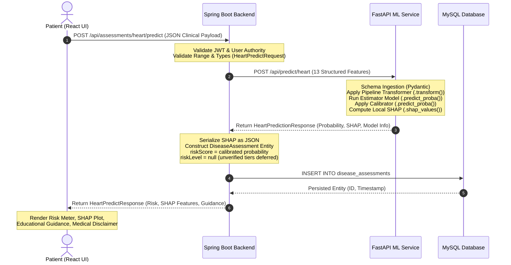
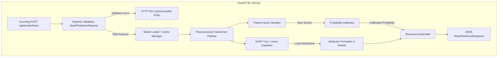
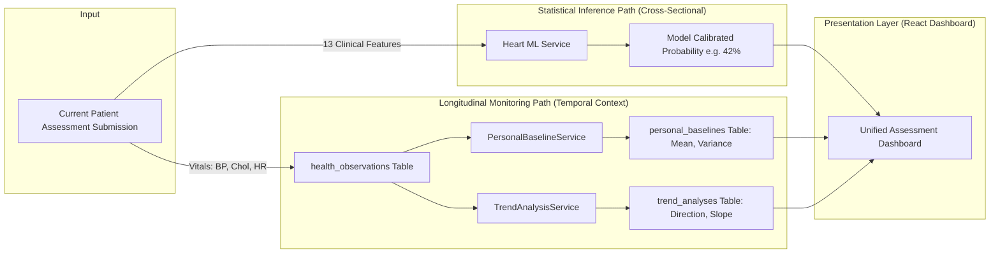
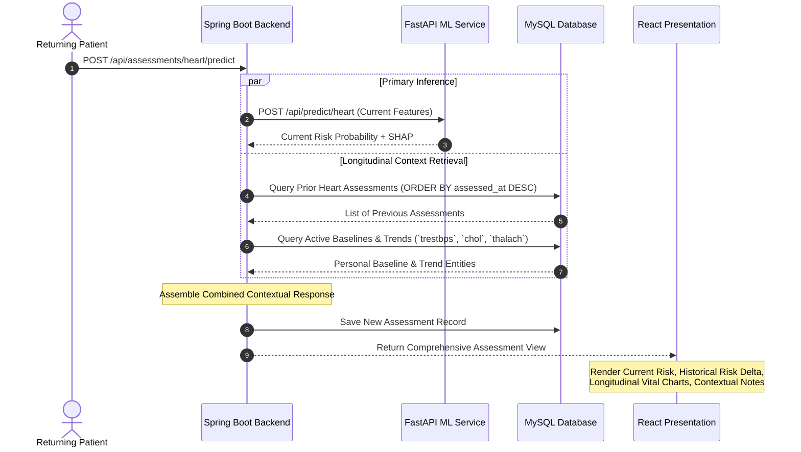
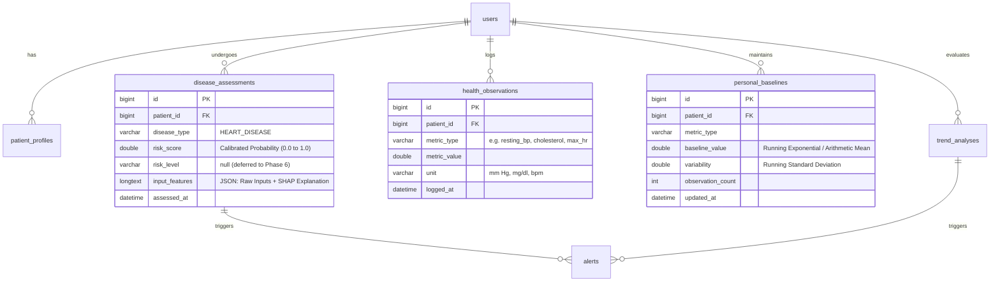
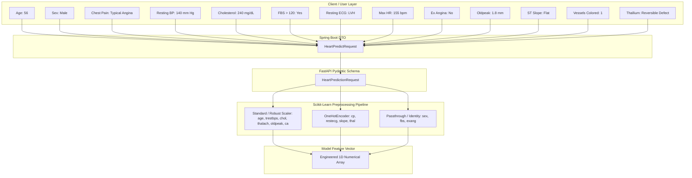
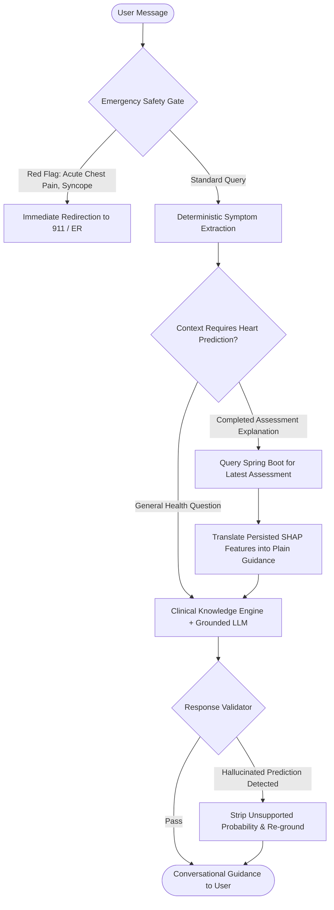
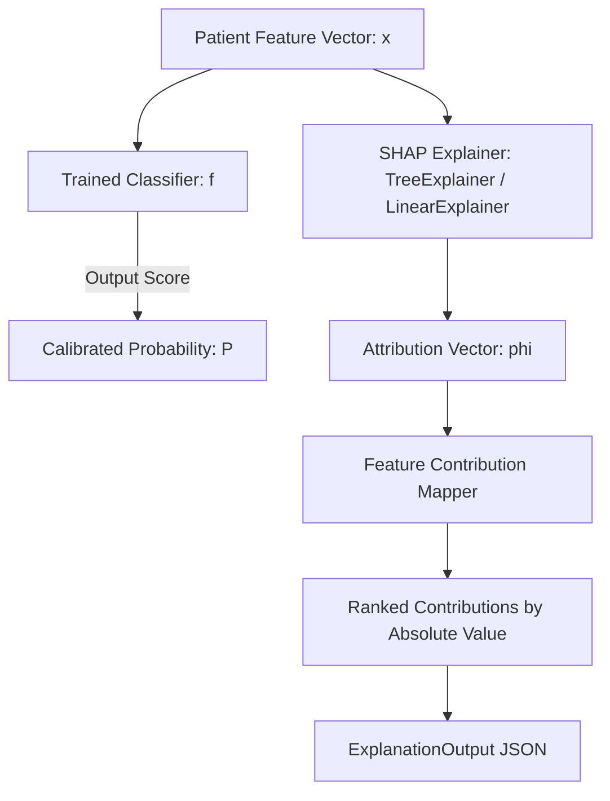

# Heart Disease — Disease-Specific Architecture Specification (Phase 2)

**Document Version**: 1.0.0  
**Phase**: Phase 2 — Disease-Specific Architecture  
**Parent Architecture**: [`docs/ARCHITECTURE.md`](file:///d:/smart-healthcare-platform/docs/ARCHITECTURE.md)  
**Upstream Artifacts**: [`docs/HEART_DATASET_ANALYSIS.md`](file:///d:/smart-healthcare-platform/docs/HEART_DATASET_ANALYSIS.md), [`docs/HEART_USER_JOURNEYS.md`](file:///d:/smart-healthcare-platform/docs/HEART_USER_JOURNEYS.md)  
**Status**: Complete & Verified  

---

## 1. System Overview & Architectural Placement

The **Heart Disease** risk prediction and monitoring module operates as a disease-specific component within the broader Smart Healthcare Platform. It strictly adopts the platform's multi-tier distributed microservice architecture:

```
┌─────────────────────────────────────────────────────────────────────────────┐
│                             PRESENTATION LAYER                              │
│                      React Single-Page Application                          │
│               - Heart Assessment Form & Modal Interface                     │
│               - Risk Probability & SHAP Attribution Visualizer              │
│               - Longitudinal Vital Trend & Baseline Dashboard               │
└──────────────────────────────────────┬──────────────────────────────────────┘
                                       │ HTTP / REST (JWT Auth)
                                       ▼
┌─────────────────────────────────────────────────────────────────────────────┐
│                        ORCHESTRATION & DOMAIN LAYER                         │
│                           Java Spring Boot 3                                │
│       - Security, Authentication & Role-Based Access Control                │
│       - Assessment Orchestration (`HeartAssessmentService`)                │
│       - Data Persistence (`DiseaseAssessmentRepository`)                    │
│       - Personal Baseline Engine (`PersonalBaselineService`)                │
│       - Longitudinal Trend Engine (`TrendAnalysisService`)                  │
└──────────────┬──────────────────────────────────────────────┬───────────────┘
               │ Internal REST                                │ JPA / Hibernate
               ▼                                              ▼
┌──────────────────────────────┐              ┌───────────────────────────────┐
│     ML INFERENCE SERVICE     │              │    PERSISTENCE STORE (MySQL)  │
│        Python FastAPI        │              │  - `users`, `patient_profiles`│
│ - Pipeline Preprocessing     │              │  - `disease_assessments`      │
│ - Calibrated Heart Model     │              │  - `health_observations`      │
│ - SHAP Explainer Engine      │              │  - `personal_baselines`       │
└──────────────▲───────────────┘              │  - `trend_analyses`, `alerts` │
               │ Internal REST                └───────────────────────────────┘
               │ (Context / Prediction)
┌──────────────┴───────────────┐
│       CHATBOT SERVICE        │
│   FastAPI + Ollama / LLM     │
│ - Emergency Safety Gate      │
│ - Symptom Extraction         │
│ - Educational Explanation    │
└──────────────────────────────┘
```

### Architectural Principles
1. **Separation of Concerns**:
   - **React** is exclusively the presentation and interaction layer.
   - **Spring Boot** is the single source of truth for business orchestration, user identity, and persistence.
   - **Python ML Service** is the mathematical inference engine for statistical risk calculation and SHAP attributions.
   - **Chatbot Service** is the conversational NLP and educational assistant. It is strictly prohibited from executing statistical predictions.
   - **MySQL** is the unified relational database.
2. **Reusability of Core Platform Infrastructure**: Heart Disease reuses standard platform tables (`disease_assessments`, `health_observations`, `personal_baselines`, `trend_analyses`), Spring Boot security filters, and React layout primitives without duplicating global boilerplate.
3. **Heart ML Model as an Analytical Component (Not the Sole Entry Point)**:
   - The Heart ML model is an analytical component that activates when a patient possesses structured, validated clinical/laboratory data.
   - The platform supports three entry pathways:
     1. **Pathway 1 (Symptoms)**: Routes directly to the Chatbot service for acute safety triage and symptom inquiry without demanding laboratory values.
     2. **Pathway 2 (Health Monitoring)**: Reuses `health_observations`, `PersonalBaselineService`, and `TrendAnalysisService` to track vitals (blood pressure, heart rate) longitudinally without forcing disease-specific ML inference.
     3. **Pathway 3 (Clinical Data Screening)**: Routes to `HeartDiseaseAssessmentModal` and executes the 13-feature ML inference pipeline when validated reports exist.
4. **Missing-Data Boundaries**:
   - The system strictly refuses to fabricate or impute missing clinical values with population averages.
   - Vague inputs (e.g. "My BP is high") are clarified rather than translated into arbitrary numeric values.
   - When required clinical values are missing, alternative pathways (symptom conversation, vital monitoring) remain accessible and active.

---

## 2. Phase Lifecycle & Development Boundaries

To preserve scientific rigor and prevent premature implementation, Heart Disease development adheres to an explicit phase boundary lifecycle:

```
Phase 0: Dataset Understanding & Provenance (COMPLETED)
   │
Phase 1: User Journeys & Functional Specification (COMPLETED)
   │
Phase 2: Disease-Specific Architecture Specification (CURRENT)
   │
Phase 3: Feature Engineering & Data Design (FUTURE)
   │
Phase 4: Preprocessing Pipeline Construction (FUTURE)
   │
Phase 5: Machine Learning Experimentation & Model Selection (FUTURE)
   │
Phase 6: Clinical Threshold Analysis & Operating Point Selection (FUTURE)
   │
Phase 7: Probability Calibration (Platt / Isotonic) (FUTURE)
   │
Phase 8: SHAP Explainability Serialization (FUTURE)
   │
Production Integration: Spring Boot, FastAPI, MySQL, React Wiring (FINAL)
```

### Phase Responsibility Matrix
| Component / Capability | Responsible Phase | Architectural Status in Phase 2 |
| :--- | :--- | :--- |
| Raw Dataset Ingestion & Checksum Verification | **Phase 0** | **Complete & Verified** (`processed.cleveland.data`) |
| User Journeys & Functional Bounds | **Phase 1** | **Complete & Verified** (`docs/HEART_USER_JOURNEYS.md`) |
| System Architecture, Data Flow, Layer Contracts | **Phase 2** | **Current Deliverable** (`docs/HEART_ARCHITECTURE.md`) |
| Structured Schema & Validation Boundary Design | **Phase 3** | Conceptual design only; no code implementation |
| Missing-value Imputation & One-Hot Transformer Fit | **Phase 4** | Conceptual design only; no pipeline code written |
| Model Training (Logistic Regression, RF, XGBoost) | **Phase 5** | **Strictly prohibited in Phase 2** |
| Risk-tier Selection & Threshold Optimization | **Phase 6** | **Strictly prohibited in Phase 2** |
| Calibration Fitting (Isotonic Regression / Sigmoid) | **Phase 7** | **Strictly prohibited in Phase 2** |
| SHAP Explainer Tree / Kernel Serialization | **Phase 8** | Conceptual design only; no explainer fitted |
| Spring Boot DTOs, Controllers & React Form Modals | **Production Integration** | Designed as target integration; not implemented |

---

## 3. End-to-End Data Flow

The complete lifecycle of a Heart Disease assessment flows through 6 distinct stages across the platform:



---

## 4. Heart ML Service Architecture

The Python FastAPI ML microservice (`ml-service/`) hosts the mathematical models and explainers for Heart Disease alongside existing disease models (e.g. Liver Disease).

```
ml-service/
├── app/
│   ├── main.py                     # API routing, lifespan pre-warming, CORS
│   ├── schemas.py                  # Pydantic input/output schemas (HeartPredictRequest/Response)
│   ├── preprocessing.py            # Feature transformation pipelines
│   ├── model.py                    # Inference orchestrator, artifact loader, singleton cache
│   └── explanation.py              # SHAP attribution calculations
└── artifacts/
    ├── liver/                      # Existing Liver production artifacts (UNTOUCHED)
    └── heart/                      # Future Heart production artifacts (Phase 8)
        ├── heart_model_bundle.joblib
        └── metadata.json
```

### Module Responsibilities & Architectural Flow



#### A. Input Schema Validation
- Pydantic models validate data types, range bounds, and categorical values before any numeric operation.
- Reconciles aliases (e.g. `chestPainType` vs `cp`, `stSlope` vs `slope`).

#### B. Preprocessing Pipeline (`heart_pipeline`)
- Applies imputer transformers fitted strictly on training data (Phase 4).
- Encodes nominal categorical variables (`cp`, `restecg`, `thal`) using one-hot encoding.
- Scales continuous variables (`age`, `trestbps`, `chol`, `thalach`, `oldpeak`) using `StandardScaler` or `RobustScaler` as determined in Phase 4.

#### C. Model Inference
- Executes `.predict_proba()` against the selected production estimator (Logistic Regression, Random Forest, or XGBoost, determined empirically in Phase 5).

#### D. Probability Calibration Engine
- Calibrates raw classifier output via Isotonic Regression or Platt Sigmoid scaling (Phase 7) to guarantee that output scores represent true empirical probabilities.

#### E. Explainability Engine (`SHAP`)
- Computes local additive feature attributions ($\phi_i$) for the single observation against the background training dataset (Phase 8).
- Formats features into human-readable labels, raw values, attribution magnitudes, and directional impacts (`INCREASES_RISK` vs `DECREASES_RISK`).

#### F. Error Handling & Resilience
- If the artifact bundle is missing: returns `HTTP 503 Service Unavailable`.
- If feature vectors fail pipeline transform: returns `HTTP 422 Unprocessable Entity`.
- Under no circumstance does the service invent a random or default probability.

---

## 5. Personalization & Context Architecture

The platform architecture enforces an unbreachable separation between **Cross-Sectional Statistical Risk** and **Longitudinal Individual Baseline Deviation**:



### Architectural Guardrails
1. **Non-Corruption of Model Weights**: The personal baseline engine does NOT modify, adjust, or multiply the ML model's output probability.
2. **Distinct Diagnostic Roles**:
   - The ML model answers: *"What is the statistical likelihood of coronary artery disease given this clinical pattern?"*
   - The baseline engine answers: *"How has this specific patient's resting blood pressure or cholesterol shifted over the past 6 months?"*
3. **No Synthetic Formulas**: Arbitrary formulas like $\text{Risk}_{\text{final}} = \text{Probability} \times (1 + \text{Deviation})$ are strictly forbidden. Both signals are presented side-by-side with transparent clinical attribution.

---

## 6. Returning Patient Assessment Architecture

When an established patient completes a new Heart Disease assessment, the platform executes a dual-path workflow:



- **Delta Calculation**: Computes the difference between current probability and immediately preceding assessment ($\Delta = P_t - P_{t-1}$).
- **Contextual Ingestion**: Resting vitals (`trestbps`, `chol`, `thalach`) logged during the assessment automatically generate new rows in `health_observations`, updating personal baselines seamlessly.

---

## 7. Database Entity Relationship & Mapping

Heart Disease integrates directly into the existing generic relational schema without introducing redundant tables:



### Table Mapping for Heart Disease
1. **`disease_assessments`**:
   - `disease_type`: `HEART_DISEASE` (from `com.smarthealth.platform.entity.DiseaseType.HEART_DISEASE`).
   - `risk_score`: Stores the genuine calibrated probability (e.g. `0.428`).
   - `risk_level`: Persisted as `null` until empirical risk tiers are clinically validated in Phase 6.
   - `input_features`: Serialized JSON payload containing:
     - `submittedInputs`: Map of the 13 raw clinical values.
     - `shapExplanation`: Serialized `ExplanationOutput` object containing `baseValue` and `features`.
2. **`health_observations`**:
   - Metric keys utilized by Heart Disease: `resting_blood_pressure`, `serum_cholesterol`, `max_heart_rate`, `fasting_blood_sugar`.

---

## 8. Assessment Data Contract & Transformation Pipeline



---

## 9. API Boundaries & Layer Separation

```
[React Frontend]
       │
       ▼  POST /api/assessments/heart/predict
[Spring Boot: HeartPredictController]
       │
       ▼  HeartAssessmentService.predict(request)
[Spring Boot: MlServiceClient]
       │
       ▼  POST http://localhost:8001/api/predict/heart
[FastAPI: app.main.predict_heart_disease]
       │
       ▼  app.model.predict_heart(request)
[FastAPI: Artifact Pipeline & Model Execution]
```

### Architectural Responsibilities by Layer
- **React Frontend**: Form validation, accessible input widgets, user-friendly labels, display of probabilities, SHAP charts, and safety disclaimers.
- **Spring Boot Backend**:
  - Validates user authorization (JWT).
  - Validates request payload bounds using Jakarta Validation (`@Min`, `@Max`, `@NotNull`).
  - Calls ML service over private internal network.
  - Persists assessment history and audit records in MySQL.
  - Manages transaction boundaries.
- **FastAPI ML Service**:
  - Encapsulates Python numerical stack (`scikit-learn`, `numpy`, `pandas`, `shap`, `joblib`).
  - Stateless execution: accepts feature vector, returns prediction and explanation.
  - Pre-warms model bundle on service startup.

---

## 10. Conversational Chatbot Integration Architecture

The Conversational Chatbot service (`chatbot-service/`) interacts with the Heart Disease domain under strict architectural separation:



### Core Chatbot Architectural Constraints
1. **No Predictive Logic**: The chatbot codebase contains zero ML model weights, regression estimators, or classification matrices.
2. **Authoritative Prediction Link**: If a user asks *"What is my heart risk?"*, the chatbot instructs the user to complete the structured Heart Disease Assessment or retrieves an already persisted prediction from Spring Boot.
3. **Emergency Precedence**: The deterministic `SafetyChecker` intercepts acute ischemic symptoms (e.g. crushing substernal chest pain radiating to left arm or neck) before the LLM synthesis pipeline executes.

---

## 11. Explainability Architecture (SHAP)



### SHAP Specification
- **Base Value ($E[f(x)]$ or Base Probability)**: Expected model risk over the training distribution.
- **Local Feature Attributions ($\phi_i$)**: Exact contribution of each feature to the individual prediction:
  $$f(x) = E[f(x)] + \sum_{i=1}^{M} \phi_i$$
- **Directional Classification**:
  - `INCREASES_RISK`: $\phi_i > 0$
  - `DECREASES_RISK`: $\phi_i < 0$
  - `NEUTRAL`: $\phi_i = 0$
- **Feature Display Names**: Internal column keys (`thal`, `ca`, `cp`) are mapped to clean clinical labels (*"Thallium Scintigraphy Defect"*, *"Fluoroscopy Vessels"*, *"Chest Pain Presentation"*).

---

## 12. Failure Modes & Architectural Resilience

| Failure Scenario | Detecting Layer | Architectural Handling & Response |
| :--- | :--- | :--- |
| **Malformed JSON / Missing Fields** | Spring Boot / FastAPI | Reject request immediately with `HTTP 400 Bad Request` or `HTTP 422 Unprocessable Entity`. Detailed field-level error messages returned. |
| **Physiologically Out-of-Bounds Value** | Spring Boot DTO Validation | Request blocked before network dispatch to ML service. User prompted to correct erroneous input. |
| **ML Service Offline / Unreachable** | Spring Boot `MlServiceClient` | Throws `MlServiceException`. Spring Boot returns `HTTP 503 Service Unavailable`. No fallback or synthetic probability is ever fabricated. |
| **Model Artifact File Corrupted / Missing** | FastAPI `load_heart_bundle` | FastAPI returns `HTTP 503 Service Unavailable` with `"Heart model artifact unavailable"`. Logged at `ERROR` level. |
| **SHAP Explanation Failure** | FastAPI `explain_prediction` | If SHAP computation encounters an exception, the calibrated probability is preserved, and the explanation field returns a degraded status with an empty feature list rather than aborting the entire risk calculation. |
| **Database Failure During Persistence** | Spring Boot `@Transactional` | Transaction rollbacks cleanly. Controller returns `HTTP 500 Internal Server Error`. Unpersisted predictions are not returned to the user. |
| **Chatbot Down or Unresponsive** | React Client | Assessment module functions completely independently of chatbot status. |
| **Acute Medical Red Flag Detected** | Chatbot `SafetyChecker` | Immediate bypass of standard conversational flow; triggers high-priority modal with emergency service guidance. |

---

## 13. Primary Output Metric Policy (No Arbitrary Risk Tiers)

To ensure clinical and mathematical integrity:
1. **Probability as Primary Output**: The fundamental quantitative output of the Heart Disease ML pipeline is the **calibrated probability** ($P \in [0.0, 1.0]$).
2. **Prohibition of Unverified Tiers in Phase 2**: The architecture explicitly avoids partitioning probabilities into arbitrary thresholds (e.g., `< 0.35` = LOW, `0.35–0.65` = MODERATE, `> 0.65` = HIGH).
3. **Phase Sequencing**:
   - Optimal operating thresholds, sensitivity-specificity trade-offs, and screening cutoffs belong strictly to **Phase 6 (Threshold Analysis)**.
   - Probability calibration curves and Brier score optimization belong strictly to **Phase 7 (Probability Calibration)**.
   - Until Phase 6 and 7 are empirically completed, the database field `risk_level` remains `null`.

---

## 14. Future IoT / Continuous Monitoring Architecture

While physical sensor integrations are out-of-scope for Phase 2, the data architecture anticipates automated vital streams:

```
[ Future Wearable Sensor / Continuous Monitor ]
                        │
                        ▼ (Authenticated Webhook / Ingestion API)
          POST /api/v1/monitoring/metrics
                        │
                        ▼
               `health_observations`
                        │
                        ▼
             `PersonalBaselineService`
                        │
                        ▼
               `personal_baselines`
                        │
                        ▼
              `TrendAnalysisService`
                        │
     ┌──────────────────┴──────────────────┐
     ▼                                     ▼
`trend_analyses`                 Pre-fill Assessment
(Alert Trigger)                  Vitals (`trestbps`, `thalach`)
```

- Ingested vitals continuously refine personal baselines.
- The Heart Disease assessment form can optionally query `/api/v1/monitoring/metrics` to pre-populate recent vitals for patient confirmation.

---

## 15. Security, Privacy & Data Boundary Specifications

1. **Patient Anonymization across ML Boundary**:
   - The ML service is stateless and unauthenticated by design.
   - Spring Boot strips all personal identifiable information (PII)—including `patientId`, `name`, `email`, and `dateOfBirth`—prior to dispatching the 13 clinical features to the Python ML service.
   - The ML service never receives, logs, or stores patient identities.
2. **Audit Logging & Verification**:
   - All assessments are immutably timestamped in MySQL.
   - Spring Boot logs assessment generation at `INFO` level without logging sensitive raw medical payloads in plain text.
3. **CORS & Service Isolation**:
   - ML inference endpoints are isolated from direct public Internet exposure, accessible exclusively through the Spring Boot internal service layer.

---

## 16. Verification Checklist

- [x] Architecture fits cleanly into existing global platform architecture (`docs/ARCHITECTURE.md`).
- [x] Clear separation of concerns between React, Spring Boot, FastAPI ML, and Chatbot.
- [x] Personal baseline engine strictly decoupled from cross-sectional ML probability.
- [x] Lifecycle phase boundaries mapped explicitly (Phases 0–8 + Production).
- [x] Primary output defined as calibrated probability; arbitrary risk levels prohibited.
- [x] Failure modes and resilience boundaries tabulated.
- [x] Security and PII minimization across ML service defined.
- [x] 5 distinct architectural diagrams included.
- [x] Raw Heart dataset verified unchanged.
- [x] Liver Disease implementation verified 100% untouched.
- [x] No ML models trained, no code modified, no services restarted.
