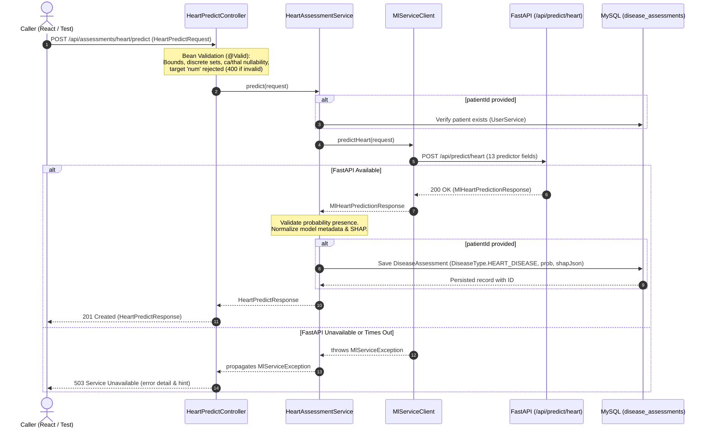

# Heart Disease — Spring Boot ML Orchestration Integration
## Stage 2: Backend Orchestration & FastAPI Client Integration

---

## 1. Purpose & Overview

This document specifies **Stage 2: Spring Boot ML Orchestration Integration** for the Heart Disease risk screening module in the Smart Healthcare Platform. 

In this stage, the Spring Boot platform backend is extended to act as the authoritative orchestration and client-facing API gateway for Heart Disease assessments. It interfaces directly with the Python FastAPI ML microservice (`smart-healthcare-ml-service`) that was productionized in Stage 1, translating client requests, enforcing strict input validation, managing optional patient-context persistence, and mapping real ML outputs (probabilities, binary classification decisions, and local SHAP explanations) back to the caller without fabricating numbers or moving ML logic into Java.

---

## 2. Stage Scope & Architectural Boundaries

```
+---------------------------------------------------------------------------------------+
|                                CLIENT LAYER (React / Mobile)                          |
+---------------------------------------------------------------------------------------+
                                      |
                 POST /api/assessments/heart/predict
                                      v
+---------------------------------------------------------------------------------------+
|                       SPRING BOOT PLATFORM BACKEND (Port 8080)                        |
|                                                                                       |
|  [Controller]        HeartPredictController                                           |
|                           | (Validates Request Body, HTTP 400 on error)               |
|                           v                                                           |
|  [Service]           HeartAssessmentService                                           |
|                           | (Resolves patient, orchestrates persistence)              |
|                           v                                                           |
|  [HTTP Client]       MlServiceClient                                                  |
|                           | (Serializes 13 clinical fields, deserializes ML response) |
|                           | (Translates HTTP errors / timeouts to 503)                |
+---------------------------------------------------------------------------------------+
                                      |
                 POST /api/predict/heart (JSON HTTP REST)
                                      v
+---------------------------------------------------------------------------------------+
|                       PYTHON FASTAPI ML MICROSERVICE (Port 8001)                      |
|                                                                                       |
|  [Inference Engine]  Logistic Regression (Robust L1, C=1.0)                          |
|  [Preprocessing]     RobustScaler + OneHotEncoder (drop='first')                      |
|  [Decision Engine]   Configured Model Classification Threshold (t = 0.31)             |
|  [Explainability]    shap.LinearExplainer (Log-Odds Output Space)                     |
+---------------------------------------------------------------------------------------+
```

### Strict Separation of Concerns
1. **Spring Boot (Platform Orchestration Layer)**:
   - Owns HTTP request/response handling and API contracts.
   - Validates input formats, discrete categorical sets, and numerical boundaries.
   - Strictly rejects the target variable `num`.
   - Communicates with the ML microservice over REST (`RestTemplate`).
   - Persists assessment records to MySQL (`disease_assessments` table) when a `patientId` is provided.
   - **Does NOT** train models, fit transformers, compute thresholds, or calculate SHAP values.
2. **FastAPI ML Microservice (`ml-service`)**:
   - Owns data preprocessing, imputation, scaling, one-hot encoding, and feature alignment.
   - Executes model inference via the serialized `heart_model_bundle.joblib`.
   - Computes model-estimated probabilities via standard logistic sigmoid.
   - Evaluates the binary prediction using the configured threshold ($0.31$).
   - Calculates local SHAP attributions in log-odds space using `LinearExplainer`.
   - **Does NOT** persist data to MySQL, manage patient accounts, or access user credentials.

---

## 3. Alignment with Core Platform Objectives

| Core Objective | Platform Role | Stage 2 Spring Boot Implementation |
| :--- | :--- | :--- |
| **#1. Personalized baseline / profile** | Establishing patient norms. | Spring Boot accepts an optional `patientId`, enabling future stages to link assessments with personalized baseline profiles. |
| **#2. Context-aware monitoring & trends** | Analyzing longitudinal sensor/clinical shifts. | Spring Boot receives structured model probabilities and normalized inputs suitable for subsequent temporal analysis. |
| **#3. Disease-specific AI/ML prediction** | Primary focus of Stage 1 & 2. | Spring Boot acts as the orchestration gateway calling the real Heart ML engine, returning model-estimated probabilities, binary decisions, and SHAP explanations. |
| **#4. Proactive alerts & decision support** | Provider notification rules. | Spring Boot preserves machine-readable directional feature contributions (`INCREASES_RISK_ESTIMATE` vs. `DECREASES_RISK_ESTIMATE`) for future alerting rules. |

---

## 4. Request Flow & Execution Lifecycle



---

## 5. Spring Boot Request & Response Contracts

### Endpoint
`POST /api/assessments/heart/predict`

### Request Schema (`HeartPredictRequest`)
Contains the exact 13 clinical predictor features established by the Cleveland Heart Disease lifecycle:

| Field | Java Type | Validation Constraints | Description |
| :--- | :--- | :--- | :--- |
| `patientId` | `Long` | Optional (nullable) | Optional patient ID for MySQL persistence. |
| `age` | `Double` | `@NotNull`, $\in [1.0, 120.0]$ | Patient age in years. |
| `sex` | `Double` | `@NotNull`, $\in \{0.0, 1.0\}$ | Biological sex ($1.0 = \text{Male}, 0.0 = \text{Female}$). |
| `cp` | `Double` | `@NotNull`, $\in \{1.0, 2.0, 3.0, 4.0\}$ | Chest pain type (1: typical, 2: atypical, 3: non-anginal, 4: asymptomatic). |
| `trestbps` | `Double` | `@NotNull`, $\in [50.0, 300.0]$ | Resting blood pressure in mm Hg on admission. |
| `chol` | `Double` | `@NotNull`, $\in [50.0, 800.0]$ | Serum cholesterol in mg/dl. |
| `fbs` | `Double` | `@NotNull`, $\in \{0.0, 1.0\}$ | Fasting blood sugar $> 120$ mg/dl ($1.0 = \text{true}, 0.0 = \text{false}$). |
| `restecg` | `Double` | `@NotNull`, $\in \{0.0, 1.0, 2.0\}$ | Resting ECG (0: normal, 1: ST-T wave abnormality, 2: LV hypertrophy). |
| `thalach` | `Double` | `@NotNull`, $\in [50.0, 250.0]$ | Maximum heart rate achieved during exercise stress test. |
| `exang` | `Double` | `@NotNull`, $\in \{0.0, 1.0\}$ | Exercise-induced angina ($1.0 = \text{yes}, 0.0 = \text{no}$). |
| `oldpeak` | `Double` | `@NotNull`, $\in [0.0, 15.0]$ | ST depression induced by exercise relative to rest. |
| `slope` | `Double` | `@NotNull`, $\in \{1.0, 2.0, 3.0\}$ | Slope of peak exercise ST segment (1: upsloping, 2: flat, 3: downsloping). |
| `ca` | `Double` | Nullable, $\in \{0.0, 1.0, 2.0, 3.0, \text{null}\}$ | Number of major vessels colored by fluoroscopy. Imputed per Phase 4 contract. |
| `thal` | `Double` | Nullable, $\in \{3.0, 6.0, 7.0, \text{null}\}$ | Thallium scintigraphy defect (3: normal, 6: fixed, 7: reversible). Imputed per Phase 4 contract. |

#### Strict Target Rejection
Any payload containing the target variable `num` is strictly rejected:
```java
@JsonProperty("num")
public void setNum(Object num) {
    throw new IllegalArgumentException("Target variable 'num' is not accepted in prediction requests.");
}
```

### Response Schema (`HeartPredictResponse`)
```json
{
  "assessmentId": 14,
  "patientId": 3,
  "assessedAt": "2026-10-01T21:34:04.450",
  "disease": "HEART_DISEASE",
  "probability": 0.8872,
  "prediction": 1,
  "threshold": 0.31,
  "thresholdDescription": "Configured model classification threshold (t=0.31) targeting >= 90% sensitivity established in Phase 6.",
  "modelName": "Logistic Regression (Robust L1)",
  "modelVersion": "1.0.0",
  "configId": "LR_robust_l1_C1.0",
  "outputSpace": "log_odds",
  "calibrationStatus": "Uncalibrated Baseline (Empirically Calibrated)",
  "explanationAvailable": true,
  "explanationOutputSpace": "log_odds",
  "shapBaseValue": -0.2514,
  "modelOutput": 2.0625,
  "positiveContributors": [
    {
      "feature": "thal",
      "transformedFeature": "cat__thal_7.0",
      "displayName": "Thallium: Reversible Defect",
      "rawValue": 7.0,
      "contribution": 0.9421,
      "absContribution": 0.9421,
      "direction": "INCREASES_RISK_ESTIMATE"
    }
  ],
  "negativeContributors": [
    {
      "feature": "thalach",
      "transformedFeature": "num__thalach",
      "displayName": "Maximum Heart Rate",
      "rawValue": 112.0,
      "contribution": -0.3142,
      "absContribution": 0.3142,
      "direction": "DECREASES_RISK_ESTIMATE"
    }
  ],
  "allContributions": [ ... ],
  "explanationError": null,
  "inputSummary": {
    "age": 63.0,
    "sex": 1.0,
    "cp": 4.0
  },
  "disclaimer": "This is a research-based risk screening tool developed for decision support experimentation. The model output is a statistical probability estimate and does NOT constitute a clinical diagnosis, prognosis, or definitive proof of coronary artery disease. The configured classification threshold (t=0.31) is an operational sensitivity-focused screening cutoff, not a medical diagnostic threshold. SHAP feature attributions explain model mathematical behavior in log-odds space and do not establish biological or medical causation. Clinical decisions must always be made by a qualified healthcare professional."
}
```

---

## 6. Configuration & Environment Management

Outbound communication with FastAPI uses the existing configuration parameter in `application.yml`:

```yaml
ml:
  service:
    base-url: ${ML_SERVICE_BASE_URL:http://localhost:8001}
```

- **Environment Override**: Configurable in containerized environments via `ML_SERVICE_BASE_URL`.
- **Default Port**: Port 8001 corresponds to the standard Uvicorn ML service instance.
- **Timeouts**: Governed by `RestTemplateConfig`:
  - Connect Timeout: 5 seconds
  - Read Timeout: 30 seconds

---

## 7. Error Handling & Safety Invariants

| Failure Scenario | HTTP Status | Response Details & Invariants |
| :--- | :--- | :--- |
| **Missing required predictor** (e.g., omitted `age`) | `400 Bad Request` | Standard `ErrorResponse` with details map specifying `"age is required"`. |
| **Target variable submitted** (`num`) | `400 Bad Request` | Rejected by Jackson with message: `"Target variable 'num' is not accepted in prediction requests."` ML service is never contacted. |
| **Invalid category** (e.g., `cp = 5.0`) | `400 Bad Request` | Validation failure detailing discrete permitted options. |
| **Out-of-range numerical bound** (e.g., `trestbps = 20.0`) | `400 Bad Request` | Boundary error detailing minimum permissible physiological threshold. |
| **ML microservice unreachable or timeout** | `503 Service Unavailable` | Returns structured JSON with `"error": "ML service unavailable"`, descriptive message, and operational startup hint. |
| **ML microservice internal 500 error** | `503 Service Unavailable` | Translated safely by `MlServiceClient` without crashing the Spring Boot container. |
| **Malformed ML response (missing probability)** | `503 Service Unavailable` | Detected by `HeartAssessmentService`; rejects transaction without fabricating default $0.0$. |
| **SHAP explanation failure (`available = false`)** | `201 Created` | Valid model probability and prediction are returned; `explanationAvailable = false`, error message captured; positive/negative contributor lists empty. Zero fabricated attributions. |

---

## 8. Verification & Quality Assurance Results

The Spring Boot Heart integration was validated against automated tests using `mvnw test`:

### 1. `HeartPredictControllerTests` (12 Tests, 0 Failures)
1. `shouldAcceptValidHeartRequestAndReturnFullPrediction`: Verifies 201 Created, complete response mapping, probability preservation, threshold (0.31), and SHAP attribution hierarchy.
2. `shouldVerifyAll13FieldsForwardedToMlService`: Verifies that all 13 predictor fields are serialized to FastAPI.
3. `shouldStrictlyRejectTargetVariableNum`: Confirms HTTP 400 rejection and verifies ML service is never invoked.
4. `shouldAcceptNullableCaAndThal`: Verifies `ca=null` and `thal=null` per Phase 4 contract.
5. `shouldPreserveExplanationUnavailableWithoutFabricatingValues`: Verifies safe fallback when SHAP fails.
6. `shouldReturn503WhenMlServiceUnreachable`: Verifies 503 response on network timeout/connection refused.
7. `shouldReturn503WhenMlServiceReturnsHttp500`: Verifies error translation when FastAPI encounters a 500.
8. `shouldRejectMalformedMlResponseMissingProbability`: Verifies no default 0.0 probability is fabricated.
9. `shouldRejectMissingRequiredField`: Verifies 400 Bad Request on missing fields.
10. `shouldRejectInvalidCategoricalValues`: Verifies discrete set validation across sex, cp, slope, and thal.
11. `shouldRejectOutOfRangeNumericalValues`: Verifies boundary limits on age and blood pressure.
12. `shouldPersistAssessmentWhenPatientIdProvided`: Verifies persistence to `disease_assessments` table under `DiseaseType.HEART_DISEASE` with un-categorized risk score.

### 2. Full Regression Suite
- Total Backend Tests: **48 passed, 0 failed** (36 pre-existing + 12 new Heart tests).
- Total ML Service Tests: **98 passed, 0 failed** (`pytest -v tests/`).
- Full End-to-End Regression: **146 passed, 0 failed**.

---

## 9. Explicitly Out-of-Scope Items

To maintain architectural focus, the following capabilities are deferred to subsequent platform stages:
- **No Spring Boot model execution**: Java does not run scikit-learn or SHAP.
- **No patient history / trend endpoints**: Historical trend endpoints for Heart assessments will be added in Stage 3.
- **No alert generation**: Alert engine integration will be implemented in Stage 4.
- **No chatbot integration**: Chatbot integration will be implemented in Stage 5.
- **No frontend / React modifications**: The React UI will be integrated in Stage 6.
- **No database schema modifications**: Stored directly into the existing `disease_assessments` table without modifying entity definitions.
